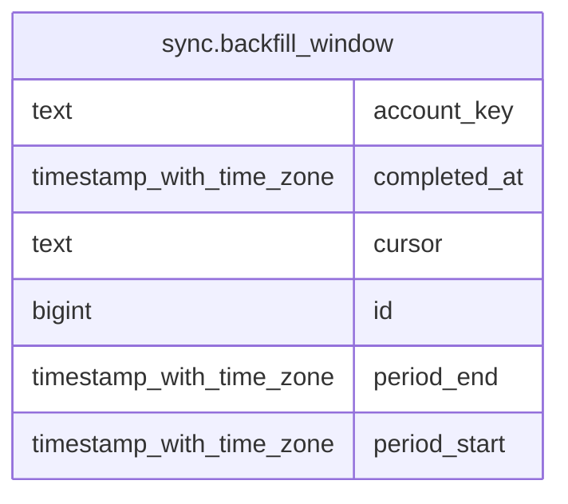

# sync.backfill_window

## Columns

| Name | Type | Default | Nullable | Children | Parents | Comment |
| ---- | ---- | ------- | -------- | -------- | ------- | ------- |
| account_key | text |  | false |  |  |  |
| completed_at | timestamp with time zone |  | true |  |  |  |
| cursor | text |  | true |  |  |  |
| id | bigint | nextval('backfill_window_id_seq'::regclass) | false |  |  |  |
| period_end | timestamp with time zone |  | false |  |  |  |
| period_start | timestamp with time zone |  | false |  |  |  |

## Constraints

| Name | Type | Definition |
| ---- | ---- | ---------- |
| backfill_window_account_key_not_null | n | NOT NULL account_key |
| backfill_window_account_key_period_start_period_end_key | UNIQUE | UNIQUE (account_key, period_start, period_end) |
| backfill_window_id_not_null | n | NOT NULL id |
| backfill_window_period_end_not_null | n | NOT NULL period_end |
| backfill_window_period_start_not_null | n | NOT NULL period_start |
| backfill_window_pkey | PRIMARY KEY | PRIMARY KEY (id) |

## Indexes

| Name | Definition |
| ---- | ---------- |
| backfill_window_account_key_period_start_period_end_key | CREATE UNIQUE INDEX backfill_window_account_key_period_start_period_end_key ON sync.backfill_window USING btree (account_key, period_start, period_end) |
| backfill_window_pkey | CREATE UNIQUE INDEX backfill_window_pkey ON sync.backfill_window USING btree (id) |

## Relations

---

> Generated by [tbls](https://github.com/k1LoW/tbls)
