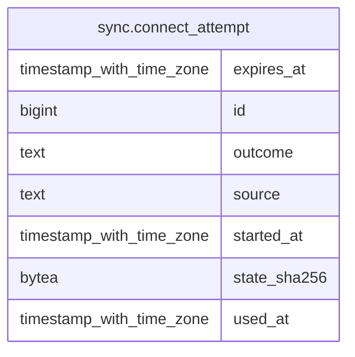

# sync.connect_attempt

## Columns

| Name | Type | Default | Nullable | Children | Parents | Comment |
| ---- | ---- | ------- | -------- | -------- | ------- | ------- |
| expires_at | timestamp with time zone |  | false |  |  |  |
| id | bigint | nextval('connect_attempt_id_seq'::regclass) | false |  |  |  |
| outcome | text |  | true |  |  |  |
| source | text |  | false |  |  |  |
| started_at | timestamp with time zone |  | false |  |  |  |
| state_sha256 | bytea |  | false |  |  |  |
| used_at | timestamp with time zone |  | true |  |  |  |

## Constraints

| Name | Type | Definition |
| ---- | ---- | ---------- |
| connect_attempt_expires_at_not_null | n | NOT NULL expires_at |
| connect_attempt_id_not_null | n | NOT NULL id |
| connect_attempt_outcome_check | CHECK | CHECK ((outcome = ANY (ARRAY['exchanged'::text, 'expired'::text, 'refused'::text]))) |
| connect_attempt_pkey | PRIMARY KEY | PRIMARY KEY (id) |
| connect_attempt_source_not_null | n | NOT NULL source |
| connect_attempt_started_at_not_null | n | NOT NULL started_at |
| connect_attempt_state_sha256_key | UNIQUE | UNIQUE (state_sha256) |
| connect_attempt_state_sha256_not_null | n | NOT NULL state_sha256 |

## Indexes

| Name | Definition |
| ---- | ---------- |
| connect_attempt_pkey | CREATE UNIQUE INDEX connect_attempt_pkey ON sync.connect_attempt USING btree (id) |
| connect_attempt_state_sha256_key | CREATE UNIQUE INDEX connect_attempt_state_sha256_key ON sync.connect_attempt USING btree (state_sha256) |

## Relations

---

> Generated by [tbls](https://github.com/k1LoW/tbls)
