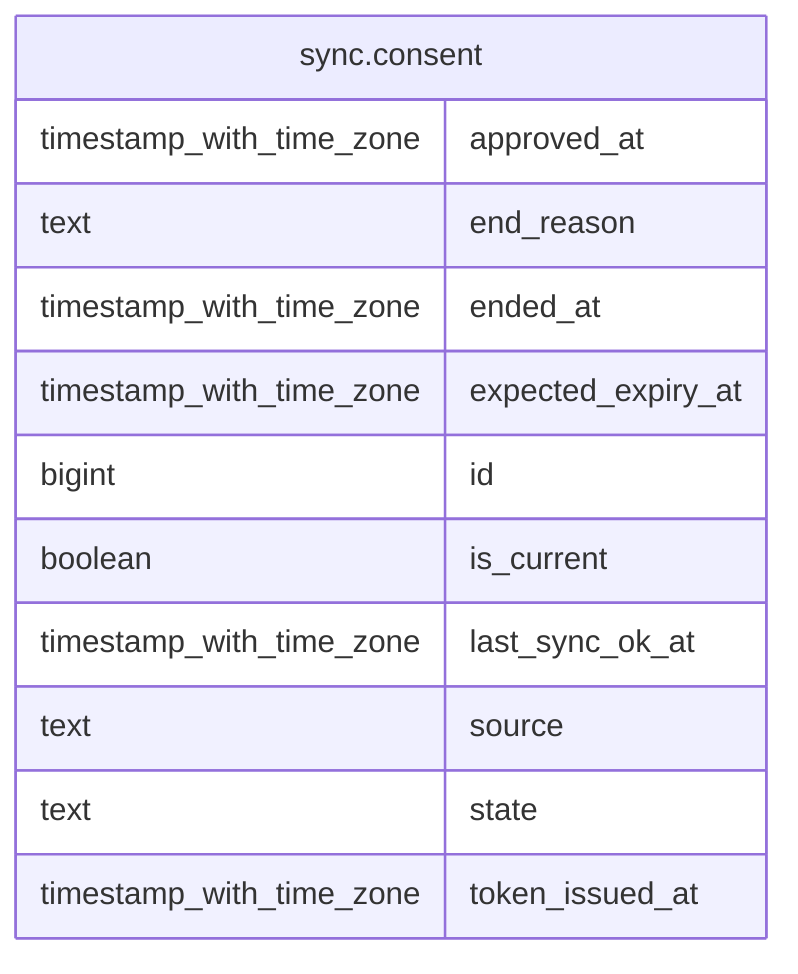

# sync.consent

## Columns

| Name | Type | Default | Nullable | Children | Parents | Comment |
| ---- | ---- | ------- | -------- | -------- | ------- | ------- |
| approved_at | timestamp with time zone |  | true |  |  |  |
| end_reason | text |  | true |  |  |  |
| ended_at | timestamp with time zone |  | true |  |  |  |
| expected_expiry_at | timestamp with time zone |  | true |  |  |  |
| id | bigint | nextval('consent_id_seq'::regclass) | false |  |  |  |
| is_current | boolean | false | false |  |  |  |
| last_sync_ok_at | timestamp with time zone |  | true |  |  |  |
| source | text |  | false |  |  |  |
| state | text |  | false |  |  |  |
| token_issued_at | timestamp with time zone |  | false |  |  |  |

## Constraints

| Name | Type | Definition |
| ---- | ---- | ---------- |
| consent_id_not_null | n | NOT NULL id |
| consent_is_current_not_null | n | NOT NULL is_current |
| consent_pkey | PRIMARY KEY | PRIMARY KEY (id) |
| consent_source_not_null | n | NOT NULL source |
| consent_state_check | CHECK | CHECK ((state = ANY (ARRAY['awaiting_approval'::text, 'active'::text, 'replaced'::text, 'lost'::text, 'expired'::text]))) |
| consent_state_not_null | n | NOT NULL state |
| consent_token_issued_at_not_null | n | NOT NULL token_issued_at |

## Indexes

| Name | Definition |
| ---- | ---------- |
| consent_one_current | CREATE UNIQUE INDEX consent_one_current ON sync.consent USING btree (source) WHERE is_current |
| consent_pkey | CREATE UNIQUE INDEX consent_pkey ON sync.consent USING btree (id) |

## Relations

---

> Generated by [tbls](https://github.com/k1LoW/tbls)
