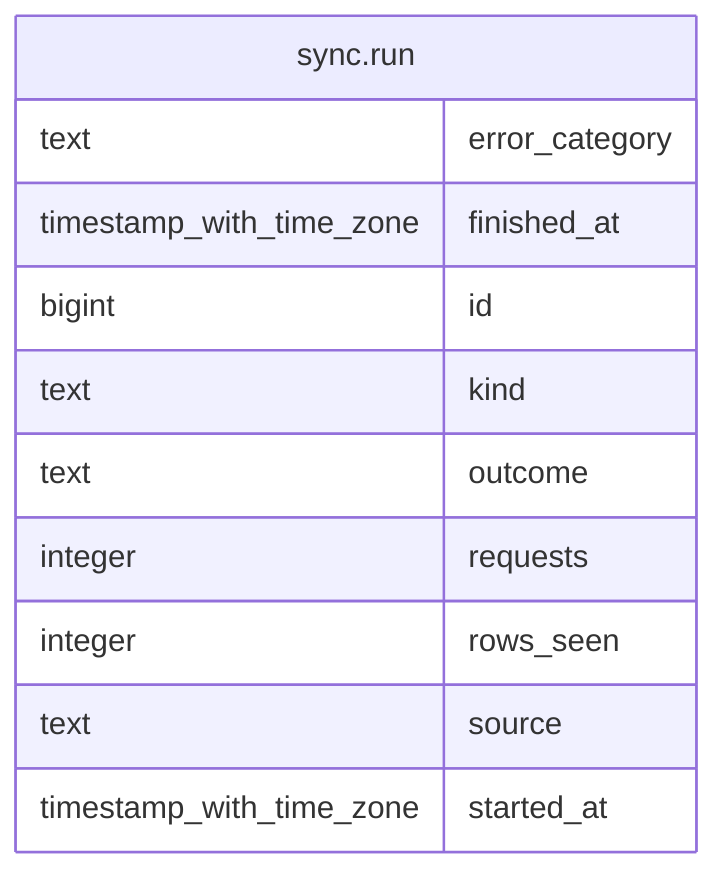

# sync.run

## Columns

| Name | Type | Default | Nullable | Children | Parents | Comment |
| ---- | ---- | ------- | -------- | -------- | ------- | ------- |
| error_category | text |  | true |  |  |  |
| finished_at | timestamp with time zone |  | true |  |  |  |
| id | bigint | nextval('run_id_seq'::regclass) | false |  |  |  |
| kind | text |  | false |  |  |  |
| outcome | text |  | true |  |  |  |
| requests | integer | 0 | false |  |  |  |
| rows_seen | integer | 0 | false |  |  |  |
| source | text |  | false |  |  |  |
| started_at | timestamp with time zone |  | false |  |  |  |

## Constraints

| Name | Type | Definition |
| ---- | ---- | ---------- |
| run_id_not_null | n | NOT NULL id |
| run_kind_not_null | n | NOT NULL kind |
| run_outcome_check | CHECK | CHECK ((outcome = ANY (ARRAY['ok'::text, 'partial'::text, 'failed'::text]))) |
| run_pkey | PRIMARY KEY | PRIMARY KEY (id) |
| run_requests_not_null | n | NOT NULL requests |
| run_rows_seen_not_null | n | NOT NULL rows_seen |
| run_source_not_null | n | NOT NULL source |
| run_started_at_not_null | n | NOT NULL started_at |

## Indexes

| Name | Definition |
| ---- | ---------- |
| run_pkey | CREATE UNIQUE INDEX run_pkey ON sync.run USING btree (id) |
| run_source_finished | CREATE INDEX run_source_finished ON sync.run USING btree (source, finished_at) |

## Relations

---

> Generated by [tbls](https://github.com/k1LoW/tbls)
